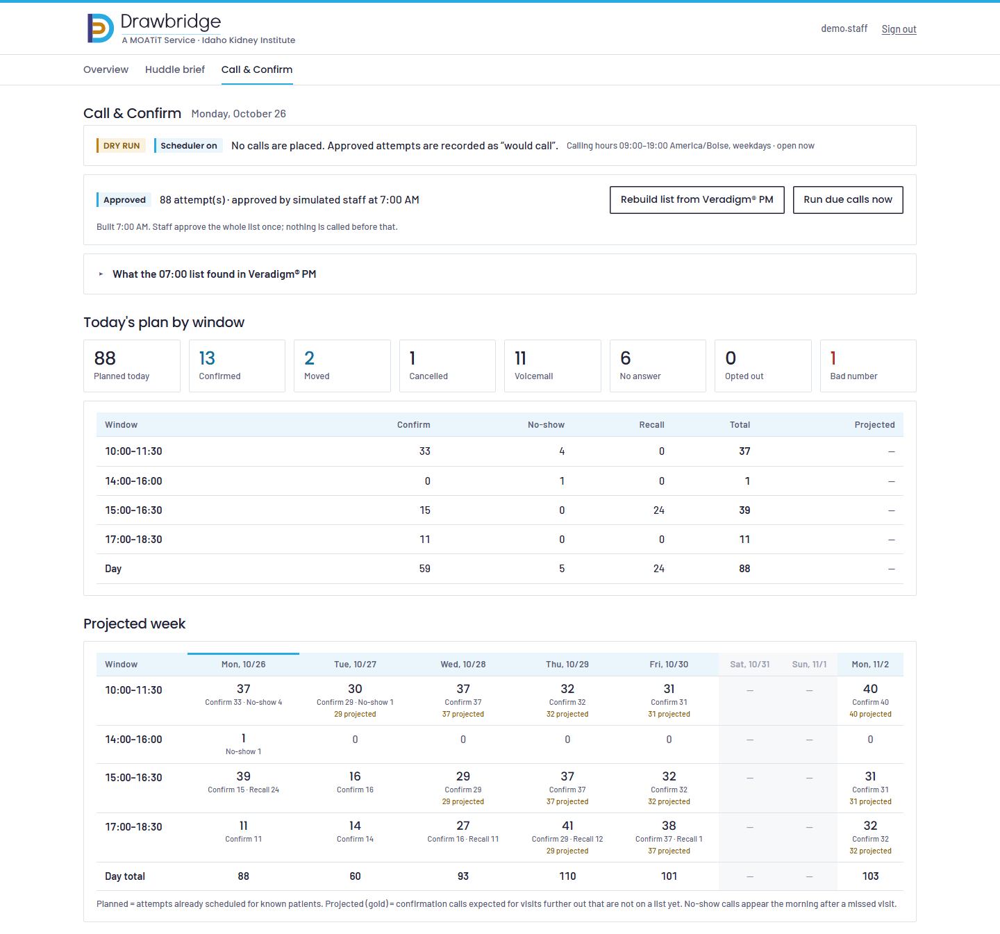
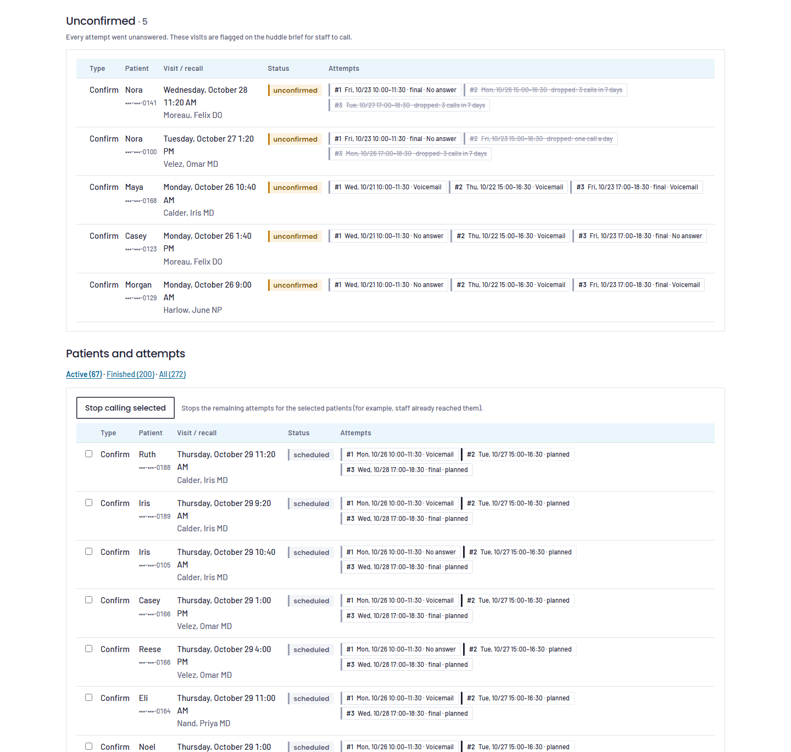
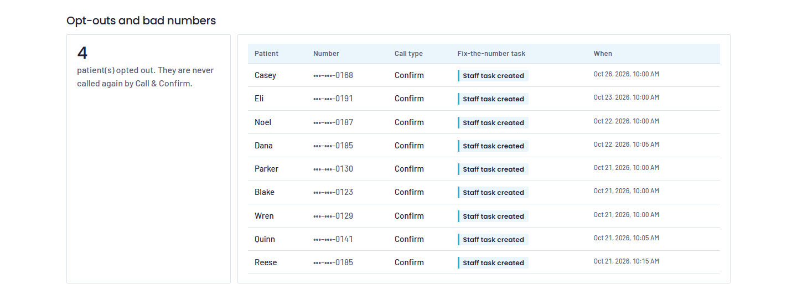
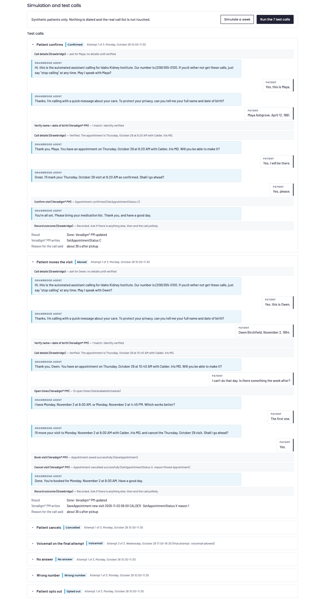
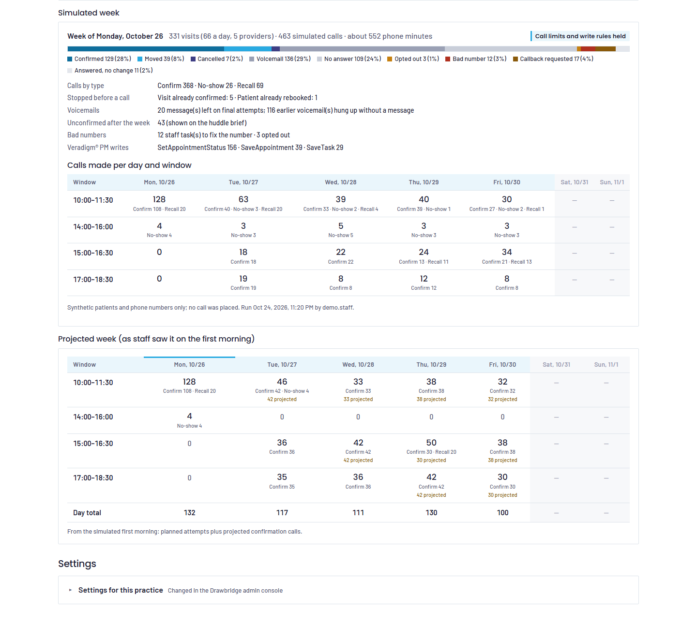
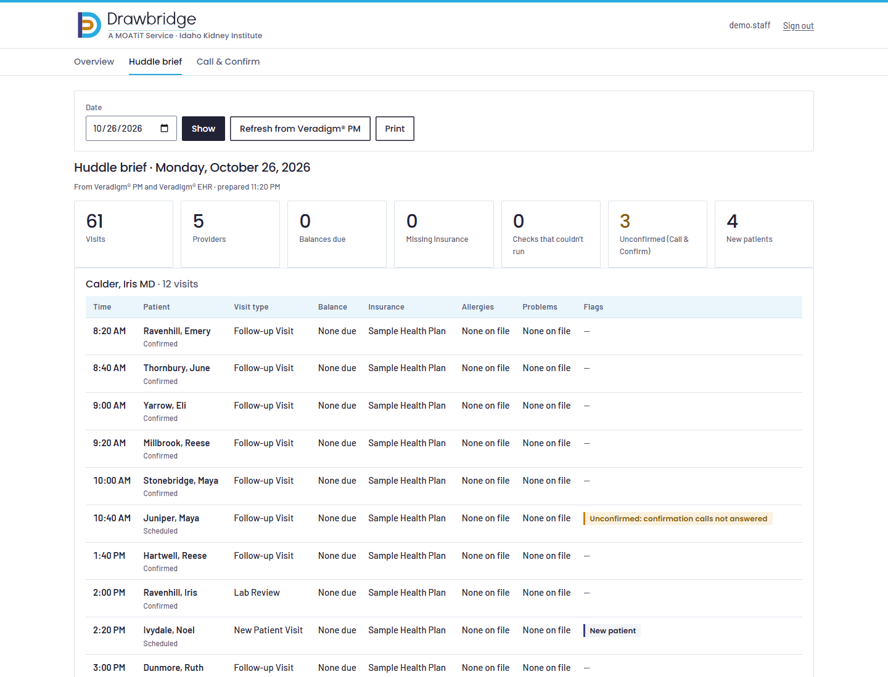

# Call & Confirm

Outbound appointment confirmation calls, plus no-show and recall calls, placed by the Drawbridge phone agent. Decided by Ali Khan on Oct 24, 2026. It uses only Veradigm® PM actions already declared in the certification assessment, so it needs no new API approvals.

**Status: dry run and simulation only.** `OUTBOUND_ENABLED` stays false, every call in this document is simulated, and every patient, phone number and visit is synthetic. Nothing here was dialed, and nothing was sent to Veradigm or Retell.

Code: `src/platform/modules/outreach/` (see its README). Staff screen: `/app/outreach` ("Call & Confirm"). Test: `npm run smoke:outreach`. Demo: `npm run demo:outreach -- --warm`.

## Why

IKI's recorded calls (Jul–Sep 2026): staff place about 1,050 appointment-related outbound calls a month (about 1,800 call-minutes). About 262 are plain confirmations or reminders, about 260 reschedules and about 200 new-patient referral bookings. About 29% of confirmation calls reach voicemail and 4% of dialed numbers are not in service. Staff call 8 AM – 5 PM.

## How it works

1. **07:00, every business day**: the list builders read Veradigm® PM.
   - Confirm: visits 1–3 business days out that are not confirmed or cancelled (`GetSchedule` status and the `GetAppointmentConfirmationResults` code on the row).
   - No-show: visits marked no show since the previous business day (`GetAppointmentsByChangeDTTM`).
   - Recall: open recalls past due with nothing booked (`GetRecalls`, `GetScheduleByPatientID`), at most 20 new a day.
   - Phone numbers come from `GetPatient`.
2. Every new job gets an **attempt plan**; each attempt uses a different part of the day:

   | Call type | Attempt 1 | Attempt 2 | Attempt 3 |
   |---|---|---|---|
   | Confirm | 3 business days before, 10:00–11:30 | 2 days before, 15:00–16:30 | 1 day before, 17:00–18:30 |
   | Confirm, booked under 3 days out | next business morning | day before, late afternoon | none |
   | No-show | same day 14:00–16:00 | next business day 10:00–11:30 | none |
   | Recall | day 0, 10:00–11:30 | day 3, 15:00–16:30 | day 7, 17:00–18:30 |

   Hard limits per patient, across all call types (TCPA healthcare exemption):
   - at most 1 attempt a day and 3 in any 7 days;
   - weekdays only, inside calling hours (09:00–19:00 clinic time);
   - not on a holiday from the settings.

   An attempt that would break a limit moves to the next business day (for a confirm call, only while that is still before the visit). If it can't move, it is dropped.
3. **A staff member approves the day's list with one click.** Nothing on an unapproved list is dialed. An attempt whose window ends before it is called is marked missed, never called late.
4. **Before every attempt** Drawbridge re-reads Veradigm® PM and stops when:
   - the visit was confirmed, moved (date or time) or cancelled;
   - the patient already rebooked, for example by calling in;
   - the patient opted out;
   - there is no usable phone number. A staff task (`SaveTask`) asks staff to fix it.

   A failed re-read means "not called", never "stop".
5. **On the call** the agent opens with the clinic name, the callback number and how to opt out. It verifies full name and date of birth before saying anything about the visit, and says the reason for the call within about a minute. After a read-back and a "yes", it may write only these:
   - `SetAppointmentStatus` C (confirm);
   - `SetAppointmentStatus` X with a reason (cancel);
   - `SaveAppointment` after `GetAvailableSchedule` (move or book);
   - `SaveTask` (anything else).

   It never markets or discusses billing.
6. **Voicemail**: a message only on the final attempt, with no details: clinic name, "about an upcoming appointment" and the callback number. Earlier attempts hang up.
7. After the final attempt an unanswered confirm job goes on the **Unconfirmed** list. That list shows on the Call & Confirm screen and as a flag on the huddle brief.

## Settings (per practice)

Exact shape, served and saved by `GET/PUT /unity/api/outreach/settings` (tool key). This is the shape the admin console builds against. Defaults:

```json
{
  "enabled": false,
  "mode": "dry_run",
  "call_types": {"confirm": true, "no_show": true, "recall": true},
  "confirm": {"attempts": [{"days_before": 3, "window": "10:00-11:30"}, {"days_before": 2, "window": "15:00-16:30"}, {"days_before": 1, "window": "17:00-18:30"}]},
  "no_show": {"attempts": [{"day_offset": 0, "window": "14:00-16:00"}, {"day_offset": 1, "window": "10:00-11:30"}]},
  "recall": {"attempts": [{"day_offset": 0, "window": "10:00-11:30"}, {"day_offset": 3, "window": "15:00-16:30"}, {"day_offset": 7, "window": "17:00-18:30"}]},
  "limits": {"max_per_day": 1, "max_per_7_days": 3, "calling_hours": "09:00-19:00", "weekdays_only": true, "holidays": []},
  "voicemail": "last_attempt",
  "approval": "daily_list",
  "test_allowlist": []
}
```

Validation rules:
- Limits can only go down (max 1 a day, 3 in 7 days, 3 attempts per call type).
- Calling hours stay between 08:00 and 21:00, and every window must sit inside them.
- Attempts must be on different days, in order.
- `mode: "live"` is refused unless `OUTBOUND_ENABLED=true` on the server and an allowlist is set (`test_allowlist` or `OUTBOUND_ALLOWLIST`). Even then, only allowlisted numbers are called.

## Plan endpoint

`GET /unity/api/outreach/plan?days=7` (header `x-drawbridge-key`, read-only, counts only with no names, numbers or IDs). `days` is 1–14 (default 7) starting today. The response looks like this (values shortened):

```json
{
  "practice": "default", "timezone": "America/Boise", "generated_at": "2026-10-26T16:20:00.000Z",
  "enabled": true, "mode": "dry_run",
  "days": [{
    "date": "2026-10-26", "weekday": "Mon", "calling_day": true,
    "list": {"built_at": "…", "approved_at": "…", "approved_by": "jdoe", "entries": 88, "pending_approval": 0},
    "planned":   {"confirm": 59, "no_show": 5, "recall": 24, "total": 88},
    "projected": {"confirm": 0, "no_show": 0, "recall": 0, "total": 0},
    "windows": [{"window": "10:00-11:30", "planned": {"confirm": 33, "no_show": 4, "recall": 0, "total": 37}, "projected": {"confirm": 0, "no_show": 0, "recall": 0, "total": 0}}],
    "results": {"confirmed": 13, "moved": 2, "cancelled": 1, "voicemail": 11, "no_answer": 6, "opted_out": 0, "bad_number": 1},
    "would_call": 0,
    "stopped": {"confirmed": 1}
  }],
  "totals": {"planned": {…}, "projected": {…}, "results": {…}},
  "unconfirmed": 5, "opted_out": 3, "bad_number_tasks": 12
}
```

- `planned`: attempts of known jobs (planned, on a list, approved or made).
- `projected`: confirmation attempts expected for visits further out.
- `results`: outcomes of attempts made that day.
- `would_call`: dry-run attempts.
- `stopped`: jobs ended by the re-read before a call.
- `unconfirmed`: upcoming visits on the Unconfirmed list.

## Sample week (simulation, synthetic clinic)

`npm run demo:outreach -- --dump out.json`, seed 20261026: a synthetic nephrology clinic with 5 providers and about 66 visits a business day, simulated Mon Oct 26 – Sun Nov 1, 2026.
- About 40% of future visits were already confirmed by text or portal.
- 5% of numbers are not in service; 1% of patients have no number.
- About 40 recall patients are past due.
- Simulated pickup rates: 29% voicemail, 23% no answer, the rest answered.

Monday is go-live: every unconfirmed visit 1–3 days out is called that morning. From Tuesday the load spreads over the windows.

### Projected week (the plan view on Monday morning, after the 07:00 list)

Each cell: planned + projected calls (C = confirm, N = no-show, R = recall). Planned = attempts of patients already on a list; projected = confirmation calls for visits 4+ business days out that the list builder has not picked up yet.

| Window | Mon Oct 26 | Tue Oct 27 | Wed Oct 28 | Thu Oct 29 | Fri Oct 30 | Sat Oct 31 | Sun Nov 1 |
|---|---:|---:|---:|---:|---:|---:|---:|
| 10:00–11:30 | **128** (C 108 · R 20) | **46** (C 42 · N 4, 42 projected) | **33** (C 33, 33 projected) | **38** (C 38, 38 projected) | **32** (C 32, 32 projected) | – | – |
| 14:00–16:00 | **4** (N 4) | 0 | 0 | 0 | 0 | – | – |
| 15:00–16:30 | 0 | **36** (C 36) | **42** (C 42, 42 projected) | **50** (C 30 · R 20, 30 projected) | **38** (C 38, 38 projected) | – | – |
| 17:00–18:30 | 0 | **35** (C 35) | **36** (C 36) | **42** (C 42, 42 projected) | **30** (C 30, 30 projected) | – | – |
| **Day** | **132** | **117** | **111** | **130** | **100** | – | – |

### What the simulated week actually did

| Window | Mon Oct 26 | Tue Oct 27 | Wed Oct 28 | Thu Oct 29 | Fri Oct 30 | Sat Oct 31 | Sun Nov 1 |
|---|---:|---:|---:|---:|---:|---:|---:|
| 10:00–11:30 | **128** (C 108 · R 20) | **63** (C 40 · N 3 · R 20) | **39** (C 33 · N 2 · R 4) | **40** (C 39 · N 1) | **30** (C 27 · N 2 · R 1) | – | – |
| 14:00–16:00 | **4** (N 4) | **3** (N 3) | **5** (N 5) | **3** (N 3) | **3** (N 3) | – | – |
| 15:00–16:30 | **0** | **18** (C 18) | **22** (C 22) | **24** (C 13 · R 11) | **34** (C 21 · R 13) | – | – |
| 17:00–18:30 | **0** | **19** (C 19) | **8** (C 8) | **12** (C 12) | **8** (C 8) | – | – |
| **Calls** | **132** | **103** | **74** | **79** | **75** | – | – |

| Outcome | Calls | Share |
|---|---:|---:|
| Confirmed | 129 | 28% |
| Moved / booked | 39 | 8% |
| Cancelled | 7 | 2% |
| Callback requested (staff task) | 17 | 4% |
| Answered, no change | 11 | 2% |
| Voicemail | 136 | 29% |
| No answer | 109 | 24% |
| Bad number | 12 | 3% |
| Opted out | 3 | 1% |
| **Total** | **463** | |


Week totals:
- **463 simulated calls** (368 confirm, 26 no-show, 69 recall), about 552 agent phone minutes.
- **43 visits Unconfirmed** at the end of the week (they go on the huddle brief).
- **12 bad-number staff tasks**; 3 patients opted out.
- **6 jobs stopped by the re-read before a call** (5 already confirmed, 1 already rebooked).
- **20 voicemails left**, all on final attempts. 116 earlier voicemails hung up without a message.
- **Veradigm® PM writes**: `SetAppointmentStatus` 156, `SaveAppointment` 39, `SaveTask` 29, and nothing else.
- **Per-patient limit violations: 0.**

Projected counts are an upper bound. Later attempts are not needed once a patient confirms, moves, cancels or is reached. Compare Thursday: 130 projected, 79 made.

Calls are spread across 4 windows a day: 10:00–11:30, 14:00–16:00 (no-show day 0), 15:00–16:30 and 17:00–18:30. The 17:00–18:30 window is outside IKI staff's 8–5 calling day, so the agent reaches patients when staff cannot.

## Sample test calls

Played from the staff screen ("Run the 7 test calls") or `npm run smoke:outreach`. Each call goes through the real path against a test copy of Veradigm® PM (SimUnity):
- confirm list builder;
- scheduler;
- list approval;
- the dispatcher's checks and re-read;
- the outbound agent tools (`drawbridge_outreach_context`, `drawbridge_outreach_result`);
- the phone agent's real Veradigm® PM tool code (`unity_search_patients`, `unity_confirm_appointment`, `unity_get_open_slots`, `unity_save_appointment`, `unity_cancel_appointment`, plus `SaveTask` for the bad-number task).

Only the patient's words and the agent's lines are scripted. The live agent follows `retell-prompts/outbound-outreach-agent.md`. Each call: a synthetic patient with a follow-up visit three business days out (the standard 3-attempt plan), called on the next business morning.

### 1. Patient confirms

*Attempt 1 of 3, Monday, October 26 10:00-11:30*

> `drawbridge_outreach_context`: Call details (Drawbridge) → ask for Maya; no details until verified  
> **Agent**: Hi, this is the automated assistant calling for Idaho Kidney Institute. Our number is (208) 555-0100. If you'd rather not get these calls, just say "stop calling" at any time. May I speak with Maya?  
> **Patient**: Yes, this is Maya.  
> **Agent**: Thanks. I'm calling with a quick message about your care. To protect your privacy, can you tell me your full name and date of birth?  
> **Patient**: Maya Ashgrove, April 12, 1961.  
> `unity_search_patients`: Verify name + date of birth (Veradigm® PM) → 1 match: identity verified  
> `drawbridge_outreach_context`: Call details (Drawbridge) → Verified. The appointment is Thursday, October 29 at 9:20 AM with Calder, Iris MD.  
> **Agent**: Thank you, Maya. You have an appointment on Thursday, October 29 at 9:20 AM with Calder, Iris MD. Will you be able to make it?  
> **Patient**: Yes, I will be there.  
> **Agent**: Great. I'll mark your Thursday, October 29 visit at 9:20 AM as confirmed. Shall I go ahead?  
> **Patient**: Yes, please.  
> `unity_confirm_appointment`: Confirm visit (Veradigm® PM) → Appointment confirmed (SetAppointmentStatus C)  
> **Agent**: You're all set. Please bring your medication list. Thank you, and have a good day.  
> `drawbridge_outreach_result`: Record outcome (Drawbridge) → Recorded. Ask if there is anything else, then end the call politely.  

Result: Done: Veradigm® PM updated (job `completed`, outcome `confirmed`). Veradigm® PM writes: `SetAppointmentStatus C`. Reason for the call said about 36 s after pickup.

### 2. Patient moves the visit

*Attempt 1 of 3, Monday, October 26 10:00-11:30*

> `drawbridge_outreach_context`: Call details (Drawbridge) → ask for Owen; no details until verified  
> **Agent**: Hi, this is the automated assistant calling for Idaho Kidney Institute. Our number is (208) 555-0100. If you'd rather not get these calls, just say "stop calling" at any time. May I speak with Owen?  
> **Patient**: Yes, this is Owen.  
> **Agent**: Thanks. I'm calling with a quick message about your care. To protect your privacy, can you tell me your full name and date of birth?  
> **Patient**: Owen Birchfield, November 2, 1954.  
> `unity_search_patients`: Verify name + date of birth (Veradigm® PM) → 1 match: identity verified  
> `drawbridge_outreach_context`: Call details (Drawbridge) → Verified. The appointment is Thursday, October 29 at 10:40 AM with Calder, Iris MD.  
> **Agent**: Thank you, Owen. You have an appointment on Thursday, October 29 at 10:40 AM with Calder, Iris MD. Will you be able to make it?  
> **Patient**: I can't do that day. Is there something the week after?  
> `unity_get_open_slots`: Open times (Veradigm® PM) → 10 open times (GetAvailableSchedule)  
> **Agent**: I have Monday, November 2 at 8:00 AM, or Monday, November 2 at 4:45 PM. Which works better?  
> **Patient**: The first one.  
> **Agent**: I'll move your visit to Monday, November 2 at 8:00 AM with Calder, Iris MD, and cancel the Thursday, October 29 visit. Shall I go ahead?  
> **Patient**: Yes.  
> `unity_save_appointment`: Book visit (Veradigm® PM) → Appointment saved successfully (SaveAppointment)  
> `unity_cancel_appointment`: Cancel visit (Veradigm® PM) → Appointment cancelled successfully (SetAppointmentStatus X, reason Moved Appointment)  
> **Agent**: Done. You're booked for Monday, November 2 at 8:00 AM. Have a good day.  
> `drawbridge_outreach_result`: Record outcome (Drawbridge) → Recorded. Ask if there is anything else, then end the call politely.  

Result: Done: Veradigm® PM updated (job `completed`, outcome `moved`). Veradigm® PM writes: `SaveAppointment new visit 2026-11-02 08:00 CALDER`, `SetAppointmentStatus X reason 1`. Reason for the call said about 36 s after pickup.

### 3. Patient cancels

*Attempt 1 of 3, Monday, October 26 10:00-11:30*

> `drawbridge_outreach_context`: Call details (Drawbridge) → ask for Lucia; no details until verified  
> **Agent**: Hi, this is the automated assistant calling for Idaho Kidney Institute. Our number is (208) 555-0100. If you'd rather not get these calls, just say "stop calling" at any time. May I speak with Lucia?  
> **Patient**: Yes, this is Lucia.  
> **Agent**: Thanks. I'm calling with a quick message about your care. To protect your privacy, can you tell me your full name and date of birth?  
> **Patient**: Lucia Coldwater, July 30, 1972.  
> `unity_search_patients`: Verify name + date of birth (Veradigm® PM) → 1 match: identity verified  
> `drawbridge_outreach_context`: Call details (Drawbridge) → Verified. The appointment is Thursday, October 29 at 1:20 PM with Calder, Iris MD.  
> **Agent**: Thank you, Lucia. You have an appointment on Thursday, October 29 at 1:20 PM with Calder, Iris MD. Will you be able to make it?  
> **Patient**: I can't make it. I need to cancel.  
> `unity_get_cancellation_reasons`: Cancellation reasons (Veradigm® PM) → 3 reasons  
> **Agent**: I'll cancel your appointment on Thursday, October 29 at 1:20 PM with Calder, Iris MD. Shall I go ahead?  
> **Patient**: Yes.  
> `unity_cancel_appointment`: Cancel visit (Veradigm® PM) → Appointment cancelled successfully (SetAppointmentStatus X, reason Patient Cancelled)  
> **Agent**: It is cancelled. Would you like to find a new time now?  
> **Patient**: Not now, I'll call back.  
> **Agent**: No problem. You can reach us at (208) 555-0100. Have a good day.  
> `drawbridge_outreach_result`: Record outcome (Drawbridge) → Recorded. Ask if there is anything else, then end the call politely.  

Result: Done: Veradigm® PM updated (job `completed`, outcome `cancelled`). Veradigm® PM writes: `SetAppointmentStatus X reason 3`. Reason for the call said about 36 s after pickup.

### 4. Voicemail on the final attempt

*Attempt 3 of 3, Wednesday, October 28 17:00-18:30 (final attempt: voicemail allowed)*

> `drawbridge_outreach_context`: Call details (Drawbridge) → ask for Theo; no details until verified  
> *Voicemail greeting detected.*  
> **Agent**: Hello, this is Idaho Kidney Institute calling about an upcoming appointment. Please call us back at (208) 555-0100. Thank you.  
> `drawbridge_outreach_result`: Record outcome (Drawbridge) → Recorded. Ask if there is anything else, then end the call politely.  

Result: All attempts used: on the Unconfirmed list and flagged on the huddle brief (job `unconfirmed`, outcome `voicemail`). Veradigm® PM writes: none. Reason for the call said about 8 s after pickup.

### 5. No answer

*Attempt 1 of 3, Monday, October 26 10:00-11:30*

> `drawbridge_outreach_context`: Call details (Drawbridge) → ask for Nora; no details until verified  
> *Rang 30 seconds, nobody picked up, no voicemail greeting. The agent hangs up.*  
> `drawbridge_outreach_result`: Record outcome (Drawbridge) → Recorded. Ask if there is anything else, then end the call politely.  

Result: Next attempt Tuesday, October 27 15:00-16:30 (job `scheduled`, outcome `no_answer`). Veradigm® PM writes: none.

### 6. Wrong number

*Attempt 1 of 3, Monday, October 26 10:00-11:30*

> `drawbridge_outreach_context`: Call details (Drawbridge) → ask for Eli; no details until verified  
> **Agent**: Hi, this is the automated assistant calling for Idaho Kidney Institute. Our number is (208) 555-0100. If you'd rather not get these calls, just say "stop calling" at any time. May I speak with Eli?  
> **Person who answered**: There's no Eli here. I think you have the wrong number.  
> **Agent**: I'm sorry to have bothered you. We'll update our records. Have a good day.  
> `drawbridge_outreach_result`: Record outcome (Drawbridge) → Recorded. Staff will fix the number. Apologize for the call and end it politely.  
> *Drawbridge created a staff task (SaveTask): "check and update the phone number".*  

Result: Stopped: staff task to fix the number (job `stopped`, outcome `wrong_number`). Veradigm® PM writes: `SaveTask Drawbridge: other`.

### 7. Patient opts out

*Attempt 1 of 3, Monday, October 26 10:00-11:30*

> `drawbridge_outreach_context`: Call details (Drawbridge) → ask for Ruth; no details until verified  
> **Agent**: Hi, this is the automated assistant calling for Idaho Kidney Institute. Our number is (208) 555-0100. If you'd rather not get these calls, just say "stop calling" at any time. May I speak with Ruth?  
> **Patient**: This is Ruth. Please stop calling me with these.  
> **Agent**: Understood. We won't call you with these reminders again. You can always reach us at (208) 555-0100. Goodbye.  
> `drawbridge_outreach_result`: Record outcome (Drawbridge) → Recorded. They will not get these calls again. Thank them and end the call politely.  

Result: Patient added to the opt-out list (job `completed`, outcome `opted_out`). Veradigm® PM writes: none.


## Screenshots (synthetic data, dry run)

Taken from `npm run demo:outreach -- --warm`: the real staff screens on the synthetic clinic, Monday Oct 26 at 10:20.

| | |
|---|---|
| Today's plan by window, one-click approval, projected week |  |
| Unconfirmed list and each patient's attempt timeline |  |
| Opt-outs and bad-number staff tasks |  |
| Simulated test calls (transcripts) |  |
| Simulated week (outcome mix, calls per day and window) |  |
| Huddle brief with the Unconfirmed flag |  |

## Before any real call

1. Verify the PM parameter assumptions in the sandbox (`GetSchedule` range, `GetAppointmentsByChangeDTTM`, `GetRecalls`, the confirmation result field). See the module README.
2. Set `CLINIC_CALLBACK_NUMBER` and create the outbound Retell agent with the updated prompt.
3. Test calls to staff phones only: `test_allowlist`, `OUTBOUND_ENABLED=true`, `mode: "live"`.
4. Calling real patients needs the owner's go-ahead and a code change, because live mode only ever dials allowlisted numbers.
